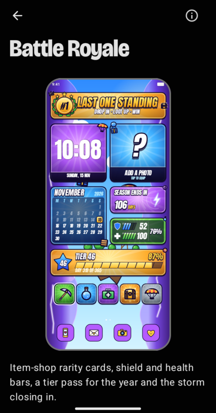
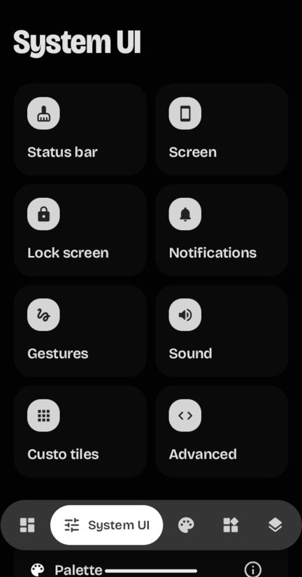

<p align="center">
  
</p>

<h1 align="center">Custo</h1>

<p align="center">
  <b>One app to customize your whole Android phone.</b><br/>
  Free · no ads · works offline · no root
</p>

<p align="center">
  <a href="../../releases/latest"><b>⬇ Download the latest APK</b></a>
</p>

<p align="center">
  
  
  
</p>
<p align="center">
  
  
  
</p>

## What it does

**Widget sets** – 35 themed bundles of a wallpaper plus matching widgets, applied in one tap: pixel-block worlds, item-shop rarity cards, Christmas, teddy bears, cake, rock, sakura, synthwave, matrix code and many more. All art is drawn in code, so everything works offline.

**Widgets** – 30+ widget types that animate when you tap them: clocks (big, stacked, minimal, analog, world, big hour), calendar, countdowns, battery, steps, screen time, water tracker, mood calendar, to-do list, moon & sun, prayer times, now playing, photo carousel, app shortcuts, and fun tap widgets (wooden fish, bubble wrap). Every widget has a full style editor (colors, gradients, borders, fonts, shadow) and fits its text to any size.

**System UI** (with [Shizuku](https://shizuku.rikka.app/), no root) – system color palette and style, status bar icons and clock, Quick Settings tile layout, navigation mode, animation speed, display size and resolution, extra dim, night light, grayscale, lock screen and always-on display, notifications and Do Not Disturb, gestures, sounds and haptics, extra Quick Settings tiles, and a raw settings editor. **Undo all** puts every system change back.

**Overlays** – edge lighting, notification light, dynamic island, battery bar, charging animation, rounded corners, network speed meter, screen tint, custom volume panel, button remapper, edge gestures, edge sidebar, Control Center, home-screen stickers.

**Themes & wallpapers** – 14+ procedural wallpaper styles, live wallpaper, video wallpaper, day/night wallpaper switching, collage maker, saved looks.

**Icons** – change app icons (via home-screen shortcuts), an icon maker, icon pack support and imported icons.

**Per-app profiles** – grayscale for social apps, fast animations and no pop-ups for games; switches back when you leave.

## Install

1. Download `custo-<version>.apk` from [Releases](../../releases/latest) and open it on your phone.
2. Android will ask to allow installs from your browser/files app – allow it once.
3. Optional: install [Shizuku](https://shizuku.rikka.app/) to unlock the System UI features (start it with Wireless debugging; Custo walks you through it).

Requires Android 12 or newer.

### Permissions, plainly

- **Shizuku** (optional): lets Custo change system settings the same way a computer over USB could. Custo only runs what you tap, and records every original value so *Undo all* can restore it.
- **Accessibility service** (optional): draws the overlays and reads volume-key presses for the custom volume panel and button actions. It does not read your screen content.
- **Notification access** (optional): edge lighting, notification light, the dynamic island and the Now playing widget. Nothing is stored or sent.
- **No internet permission.** Custo cannot send anything anywhere.

> Android 13+ may block the accessibility and notification-access toggles for apps installed outside a store ("Restricted setting"). Open App info → ⋮ → *Allow restricted settings*, or use the one-tap buttons in Custo when Shizuku is running.

## Build

```bash
git clone https://github.com/x1eddy/custo.git
cd custo
./gradlew assembleDebug        # app/build/outputs/apk/debug/app-debug.apk
./gradlew testDebugUnitTest    # unit tests
```

Needs a full JDK 17+ (with `javac`) and the Android SDK (compileSdk 37). Release builds are signed with the key described in `keystore.properties` if that file exists (it is git-ignored); otherwise they use the debug key.

## Credits

- Fonts: [Bricolage Grotesque](https://github.com/ateliertriay/bricolage), [Pixelify Sans](https://github.com/eifetx/Pixelify-Sans), [Anton](https://github.com/googlefonts/AntonFont), [Fredoka](https://github.com/hafontia/Fredoka-One), [Orbitron](https://github.com/theleagueof/orbitron), [Caveat](https://github.com/googlefonts/caveat) and [DM Serif Display](https://github.com/googlefonts/dm-fonts), all under the SIL Open Font License (see `app/src/main/assets/licenses/`, also shown in Settings → Open-source licenses).
- Per-font widget layouts are generated by `tools/gen_widget_layouts.py`.
- [Shizuku](https://github.com/RikkaApps/Shizuku) API by RikkaApps.
- Themes inspired by popular games and shows use only original art – no logos, names or characters. They are not affiliated with or endorsed by any franchise.

## License

[MIT](LICENSE)
