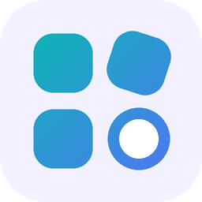
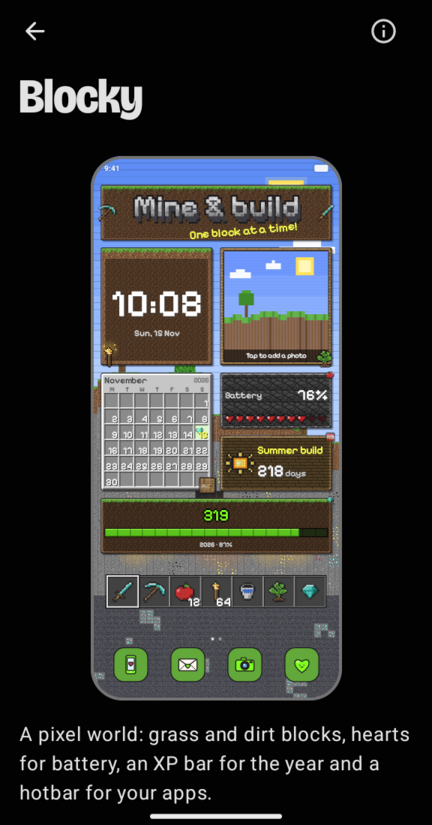
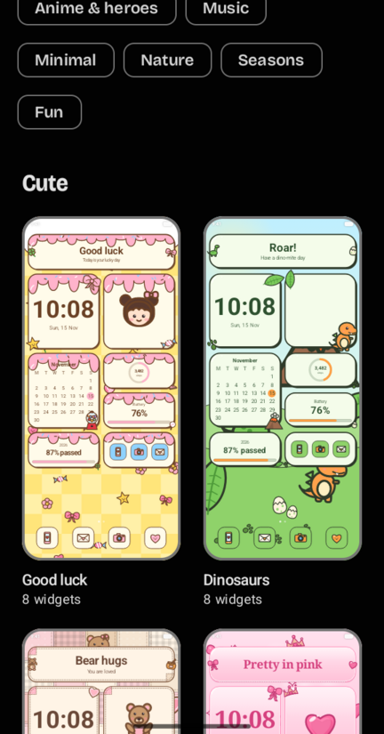
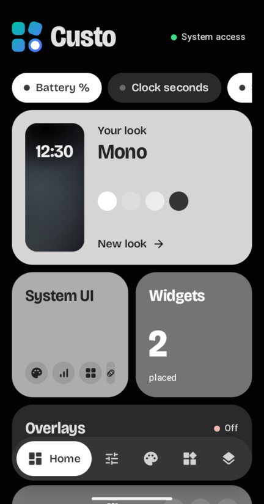
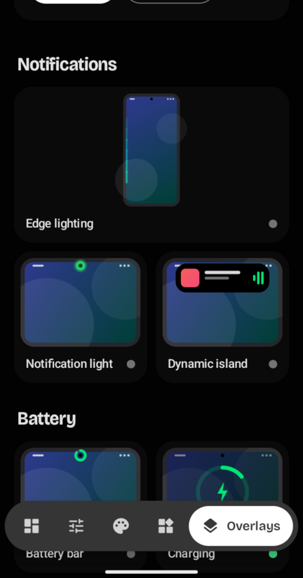

<p align="center">
  
</p>

<h1 align="center">Custo</h1>

<p align="center">
  <b>One app to customize your whole Android phone.</b><br/>
  Free · no ads · no account · no root
</p>

<p align="center">
  <a href="../../releases/latest"><b>⬇ Download the latest APK</b></a>
</p>

<p align="center">
  
  
  
</p>
<p align="center">
  
  
  
</p>

## What it does

**Widget sets** – 35 themed bundles of a wallpaper plus matching widgets, applied in one tap: pixel-block worlds, item-shop rarity cards, Christmas, teddy bears, cake, rock, sakura, synthwave, matrix code and many more. Game and anime-inspired sets can use a real wallpaper from wallhaven.cc (searched by the real name, e.g. "One Piece" or "Minecraft"), and their widgets take its colors. The frames and stickers are Custo's own art, drawn in code.

**Widgets** – 30+ widget types that animate when you tap them: clocks (big, stacked, minimal, analog, world, big hour), calendar, countdowns, battery, steps, screen time, water tracker, mood calendar, to-do list, moon & sun, prayer times, now playing, photo carousel, app shortcuts, and fun tap widgets (wooden fish, bubble wrap). Every widget has a full style editor (colors, gradients, borders, fonts, shadow) and fits its text to any size.

**System UI** (with [Shizuku](https://shizuku.rikka.app/), no root) – system color palette and style, status bar icons and clock, Quick Settings tile layout, navigation mode, animation speed, display size and resolution, extra dim, night light, grayscale, lock screen and always-on display, notifications and Do Not Disturb, gestures, sounds and haptics, extra Quick Settings tiles, and a raw settings editor. **Undo all** puts every system change back.

**Overlays** – edge lighting, notification light, dynamic island, battery bar, charging animation, rounded corners, network speed meter, screen tint, custom volume panel, button remapper, edge gestures, edge sidebar, Control Center, home-screen stickers.

**Wallpapers** – browse and search [wallhaven.cc](https://wallhaven.cc) (SFW only), save favourites to your phone, or download offline packs (One Piece, Minecraft, Nature, Space, Cyberpunk…) that are shrunk to your screen as small WebP files (usually 50–400 KB each). Long-press a picture and pick *Not this* to never see it again. Plus 14+ procedural wallpaper styles, live wallpaper, video wallpaper, day/night switching, collage maker and saved looks.

**Icons** – 30+ icon themes shown on your own apps, an icon maker (shapes, gradients, picture and puzzle backgrounds, textures, effects, stickers, per-app tweaks), icon pack support and imported icons; applied via home-screen shortcuts.

**Per-app profiles** – grayscale for social apps, fast animations and no pop-ups for games; switches back when you leave.

## Install

1. On your phone, open [the latest release](../../releases/latest) and download `custo-<version>.apk`.
2. Open the downloaded file. If Android asks, allow installs from your browser or Files app (**Settings → Install unknown apps**).
3. If **Google Play Protect** says the app is unknown or blocks it, tap **More details → Install anyway**. This shows up for any app that isn't from the Play Store.
4. Updating? From 1.1.0 on, Custo checks GitHub for new versions itself (Settings → Updates) and installs them in one tap. You can also install a new APK over the old one – your settings stay. (Releases are signed with key rotation, so they also install over earlier test builds.)
5. Optional: install [Shizuku](https://shizuku.rikka.app/) to unlock the System UI features (start it with Wireless debugging; Custo walks you through it).

Requires Android 12 or newer. If Android says *"App not installed as package conflicts with an existing package"*, you have a Custo signed with a different key (for example a build you made yourself) – uninstall it first, then install the release.

### Permissions, plainly

- **Shizuku** (optional): lets Custo change system settings the same way a computer over USB could. Custo only runs what you tap, and records every original value so *Undo all* can restore it.
- **Accessibility service** (optional): draws the overlays and reads volume-key presses for the custom volume panel and button actions. It does not read your screen content.
- **Notification access** (optional): edge lighting, notification light, the dynamic island and the Now playing widget. Nothing is stored or sent.
- **Internet** (wallpapers and updates): Custo talks to wallhaven.cc to search and download wallpapers, and to GitHub to look for new Custo versions. No account, no tracking, nothing about you is sent. Everything else works offline, and saved wallpapers stay usable without a connection.
- **Install apps** (updates only): lets Custo install its own updates after you tap *Update*. Android only accepts updates signed with Custo's key.

> Android 13+ may block the accessibility and notification-access toggles for apps installed outside a store ("Restricted setting"). Open App info → ⋮ → *Allow restricted settings*, or use the one-tap buttons in Custo when Shizuku is running.

## Build

```bash
git clone https://github.com/x1eddy/custo.git
cd custo
./gradlew assembleDebug        # app/build/outputs/apk/debug/app-debug.apk
./gradlew testDebugUnitTest    # unit tests
```

Needs a full JDK 17+ (with `javac`) and the Android SDK (compileSdk 37). Release builds are signed with the key described in `keystore.properties` if that file exists (it is git-ignored); otherwise they use the debug key.

## Credits

- Fonts: [Bricolage Grotesque](https://github.com/ateliertriay/bricolage), [Pixelify Sans](https://github.com/eifetx/Pixelify-Sans), [Anton](https://github.com/googlefonts/AntonFont), [Fredoka](https://github.com/hafontia/Fredoka-One), [Orbitron](https://github.com/theleagueof/orbitron), [Caveat](https://github.com/googlefonts/caveat) and [DM Serif Display](https://github.com/googlefonts/dm-fonts), all under the SIL Open Font License (see `app/src/main/assets/licenses/`, also shown in Settings → Open-source licenses).
- Per-font widget layouts are generated by `tools/gen_widget_layouts.py`.
- [Shizuku](https://github.com/RikkaApps/Shizuku) API by RikkaApps.
- Wallpapers from [wallhaven.cc](https://wallhaven.cc), uploaded by its community; each picture links back to its wallhaven page. Custo only shows pictures wallhaven marks as SFW.
- Widget sets inspired by popular games and shows have original titles and drawn art (no logos or characters drawn by Custo); the real name is only used as a wallhaven search term for an optional real wallpaper. Custo is not affiliated with or endorsed by any franchise or by wallhaven.

## License

[MIT](LICENSE)
